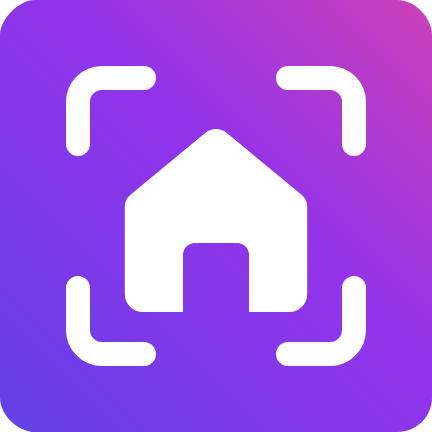
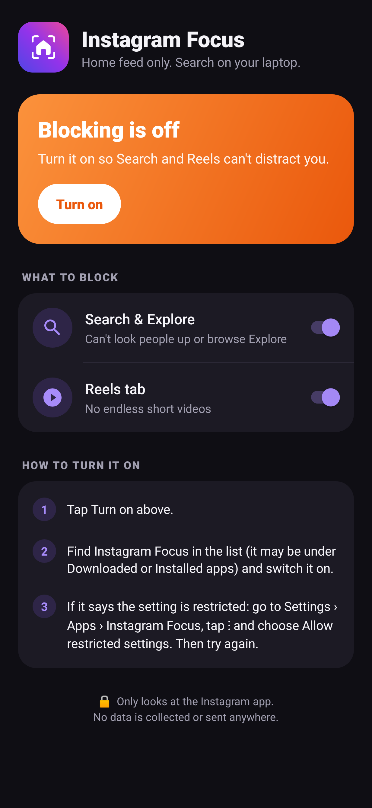
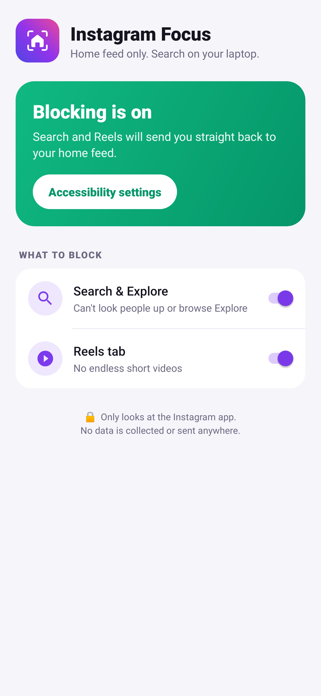
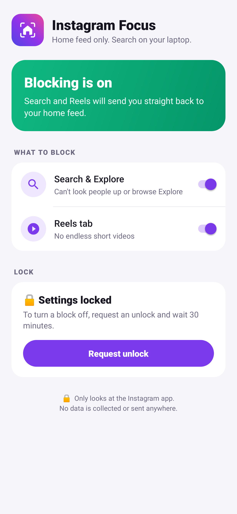

# Instagram Focus for Android

A small Android app that keeps the **Instagram app** on your home feed. If the **Search/Explore** or **Reels** tab opens, it taps Home for you straight away. Your laptop isn't affected, so search for people there.

<p>
  &nbsp;
  &nbsp;
  &nbsp;
  
</p>

## Install
1. On your phone, download [`InstagramFocus.apk`](InstagramFocus.apk) (open it on GitHub and tap the download button).
2. Open the downloaded file. If Android asks, allow your browser or file app to **install unknown apps**, then tap **Install**.
3. Open **Instagram Focus** and tap **Turn on in Accessibility settings**.
4. Find **Instagram Focus** in the list (it may be under "Installed apps" or "Downloaded apps") and turn it on.
   - If Android says the setting is **restricted** (Android 13 and newer does this for downloaded apps): go to **Settings → Apps → Instagram Focus**, tap the **⋮** menu at the top right, choose **Allow restricted settings**, then go back and turn it on.
5. Open the app again. It should say **✅ Blocking is ON**.

## Settings
The app has two switches, both on by default:
- **Block Search & Explore**
- **Block Reels tab**

## Lock
You can lock your settings so blocking is hard to switch off on impulse:
- Choose a waiting period (15 minutes, 30 minutes, 1 hour or 4 hours) and tap **Lock settings**.
- While locked you can still turn blocks **on**, but not off.
- To turn a block off, tap **Request unlock** and wait. You then get 5 minutes to make changes before it locks again by itself. You can cancel the unlock at any time.
- Moving the phone's clock forward doesn't skip the wait.

The lock is inside the app only. Android's own Settings can still switch off the Accessibility service, clear the app's storage or uninstall it, so it's a strong speed bump rather than a wall. (Watching Android's Settings screens to block that was left out on purpose, so the app keeps seeing only Instagram.)

## How it works
It uses Android's accessibility feature, which lets an app see what's on screen. It's set up so it can only see the Instagram app (`res/xml/focus_service.xml`). The only things it ever does are tap Instagram's Home tab or press Back.

## Security
Accessibility access is powerful, so the app is built to be useless to an attacker.

**What it can do:** see the Instagram app's screen, and tap Instagram's Home tab or press Back. That's all.

**Protections**
- **No permissions at all.** In particular it has no internet permission, so it can't send anything off your phone. The manifest also strips network permissions if a library ever tries to add them.
- **Only sees Instagram.** Events are limited to `com.instagram.android`, the service checks that Instagram is on screen before every action, and it doesn't ask to see other apps' windows.
- **Other people's content can't steer it.** It finds tabs by Instagram's internal view IDs. The backups that match labels like "Reels" or "Home" are only trusted inside the tab-bar strip at the bottom of the screen, so a stranger's post, comment or alt text can't make it tap anything.
- **Nothing other apps can talk to.** The blocking service isn't exported and only Android itself can connect to it. The settings screen accepts no input from other apps, ignores taps while another app draws over it (tapjacking), and can't have other apps' screens slipped into its task (task hijacking).
- **Nothing stored but your settings** (the two switches and the lock timer). These are kept in private app storage and excluded from cloud backups and device transfers. Screen content is only looked at in memory and never saved or logged.
- **Release build.** Not debuggable (so it can't be inspected or controlled over USB), code shrunk and obfuscated, no third-party libraries, signed with a private release key.
- **Checked build tools.** The Gradle download and wrapper are verified against official checksums, and Android lint reports no issues.

**What it can't protect against**
- **A fake copy.** Someone could build a look-alike "Instagram Focus" that does read your screen. Only install `InstagramFocus.apk` from this repo, and check its signing-key fingerprint (below) if you're unsure.
- **Your GitHub account.** Anyone who can push to this repo could swap the APK. Turn on two-factor authentication on GitHub.
- **Someone with your unlocked phone.** They could switch blocking off or uninstall it, but they can't use this app to read anything. A phone lock screen is your real protection.
- **A phone that is already compromised.** If your phone has been rooted by malware, no app can protect itself.

**Check an APK is genuine:** on a computer with the Android SDK, run `apksigner verify --print-certs InstagramFocus.apk`. The SHA-256 certificate digest must be:
```
c1322a85abc0044b2993d3b4c13ae32b5573c04ef684f1deacec382d38e52891
```

## Signing key
Release builds are signed with a private key that is **not** in this repo. To build a release that installs as an update over your current app, put the key file and a `keystore.properties` next to this README:
```
storeFile=/path/to/instagram-focus-release.jks
storePassword=...
keyAlias=instagramfocus
keyPassword=...
```
Both are already in `.gitignore`; never commit them. If the key is lost, uninstall the app before installing a build signed with a new key.

## Building it yourself
```
./gradlew testDebugUnitTest assembleRelease
```
This needs the Android SDK (`sdk.dir` in `local.properties`) and the signing key above. The APK is written to `app/build/outputs/apk/release/app-release.apk`.

The unit tests include `ScreenshotTest`, which uses Robolectric to render the settings screen (light and dark, blocking on and off) and the launcher icon to `app/build/screenshots/`.
